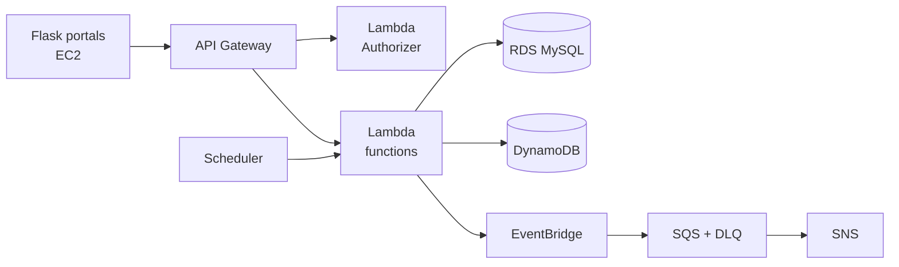

# 🩺 MediSlot

**Doctor appointment booking that stays correct under load.**

AWS-native · Event-driven · Built with Python

[Overview](#-overview) · [Architecture](#-architecture) · [Tech Stack](#-tech-stack) ·  · [Workflow](#-development-workflow) · [Roadmap](#-roadmap)

---

## ✨ Overview

MediSlot is the backend and operations platform for an online doctor appointment service, with separate portals for **doctors** and **patients**.

The hard part is correctness, not CRUD: two patients tapping "Book" on the last slot at the same instant must never both succeed.

| Guarantee | How |
|---|---|
| 🚫 **No overbooking** | DynamoDB conditional writes with a version attribute |
| 🔁 **No duplicate bookings** | Client-supplied `Idempotency-Key` |
| 🔀 **Safe rescheduling** | Step Functions saga with compensation |
| ⏳ **Fair waitlist** | One live hold offer per freed seat |
| 🔔 **Exactly-once notifications** | Dispatch log with conditional writes |
| 🔐 **Custom auth** | Hand-built JWT and refresh tokens, no managed identity service |

## 🏗 Architecture

> The full architecture diagram and design notes live in [`docs/`](docs/).

## 🧰 Tech Stack

| Area | Tools |
|---|---|
| **Compute** | Lambda, Step Functions, EC2 (Flask) |
| **Data** | RDS MySQL, DynamoDB, S3 |
| **Messaging** | EventBridge, SQS, SNS, EventBridge Scheduler |
| **Config & secrets** | SSM Parameter Store |
| **Infrastructure** | CloudFormation (parameterised stacks, Change Sets) |
| **CI/CD** | GitHub Actions with OIDC |
| **Observability** | CloudWatch, X-Ray |

## 📁 Repository Structure

## 🔀 Development Workflow

- `master` is protected: **no direct commits**.
- Work on short-lived branches cut from the latest `master`.
- Every change goes through a **pull request** with a green pipeline and one peer approval.

| Type | Branch pattern | Example |
|---|---|---|
| Feature | `feature/<description>` | `feature/booking-concurrency-control` |
| Bug fix | `fix/<description>` | `fix/refund-tier-boundary` |
| Infrastructure | `infra/<description>` | `infra/monitoring-stack-alarms` |
| Documentation | `docs/<description>` | `docs/concurrency-design-note` |

## 🗺 Roadmap

| # | Milestone | Due | Status |
|---|---|---|---|
| 1 | Design and repository kickoff | 16 Oct | ⬜ |
| 2 | Foundation, CI/CD and authentication | 23 Oct | ⬜ |
| 3 | Doctor domain | 30 Oct | ⬜ |
| 4 | Patient domain | 6 Nov | ⬜ |
| 5 | Booking engine, cancellation and refunds | 13 Nov | ⬜ |
| 6 | Reschedule saga, waitlist and notifications | 20 Nov | ⬜ |
| 7 | Observability, web app and hardening | 29 Nov | ⬜ |

## 🚀 Getting Started

> Full deployment steps will be in the runbook: `docs/runbook.md`

## 📄 Documentation

Design documents will be added to [`docs/`](docs/) as milestones complete.

---

Built as a capstone project · 2026

